<div align="center">

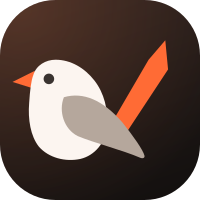

# Soroka

**Say it once. It's on the list.**

A voice assistant for the three things you keep forgetting:<br>
the shopping list, reminders, and your pills.

[](https://github.com/zhukoffsky/assistant-app/releases/tag/v0.1.0)


[](https://github.com/zhukoffsky/assistant-app/actions/workflows/build.yml)

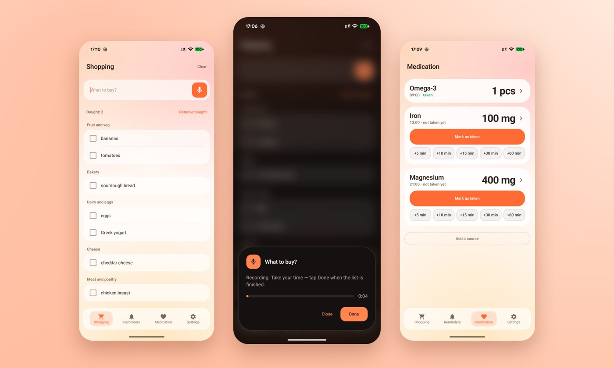

</div>

---

Most to-do apps make you open them, find the right screen, and type.
Soroka skips all of that. **Tap a widget or a tile and the microphone is
already on.** Say what you need, tap *Done*, and it's sorted and saved
before you lower the phone.

*Soroka* is Russian for magpie, the bird that remembers where it hid
everything.

## 🛒 Shopping by voice

<p align="center">
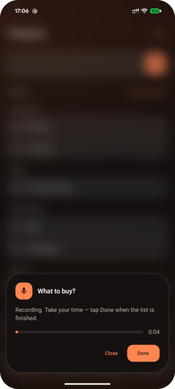
&nbsp;&nbsp;
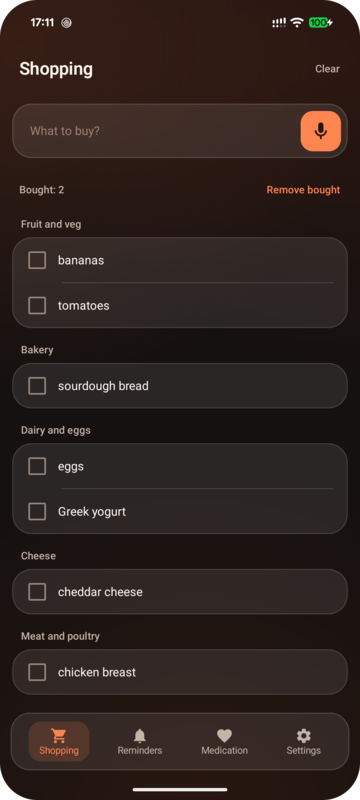
</p>

- **Dictate the way you think.** Name three things, stop to remember the
  fourth, carry on. Pauses don't end the recording; only *Done* does.
- **Ready in a third of a second.** Speech is recognized *while you talk*,
  so when you tap *Done* the text is already there. From *Done* to a
  finished list takes **0.31 s** on a Pixel 8.
- **Sorted by aisle.** "Bread milk eggs chicken" becomes four items in
  the order you walk the shop: fruit and veg first, household last. Soroka
  knows **23 aisles and about 900 products**, checked against supermarket
  catalogs in four countries.
- **Bought items sink to the bottom**, so what's left is always on top.
  *Clear* starts a fresh list in one tap.
- **No internet? No problem.** Recognition and sorting both run on the
  phone. The cloud only steps in when the phone isn't sure about an item.

## ⏰ Reminders that actually fire

<p align="center">
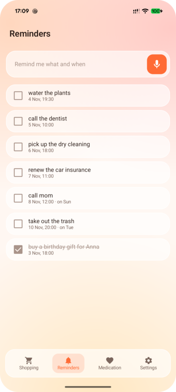
&nbsp;&nbsp;
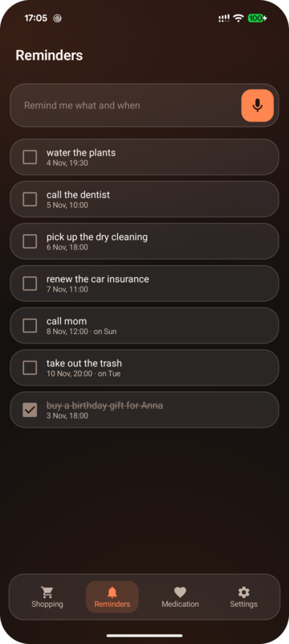
</p>

"**Tomorrow at 10 call the dentist.**" "**Every Tuesday at 8 pm take out
the trash.**" Say it naturally: Soroka picks out the time, the day and
the repeat.

- Exact alarms that fire on time even in deep battery saving, often
  within a tenth of a second.
- Reminders come back after a reboot, repeats included.
- Snooze for 10 minutes or an hour right from the notification.
- Optional one-way sync to **Google Tasks**.

## 💊 Medication without the mental math

<p align="center">
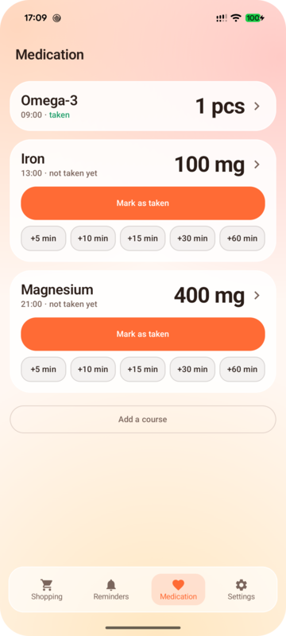
&nbsp;&nbsp;
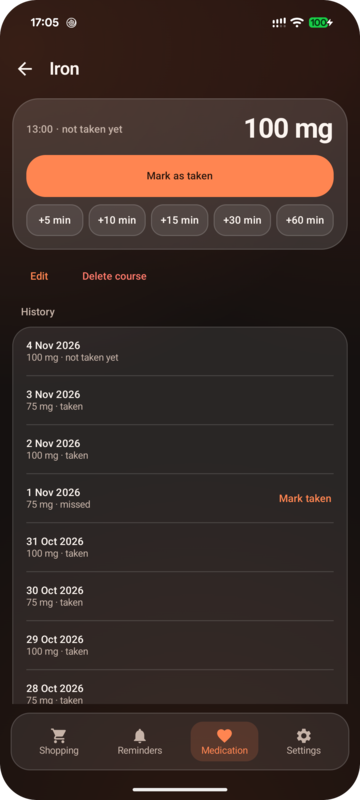
</p>

- **Several courses**, each with its own time and dose, in mg or pieces.
- **Alternating doses done right.** 100 mg one day, 75 the next: the dose
  is worked out from the date, never from a counter, so a missed day or a
  reboot can't put you out of sync.
- A notification with **Mark as taken, +15 min and +60 min**, and
  more snooze options inside the app.
- **A history you can fix.** Missed a tap? Mark the dose as taken after
  the fact.

## 🧩 Widgets for your home screen

<p align="center">
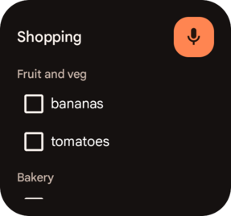
&nbsp;
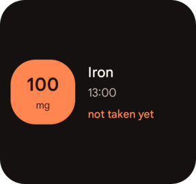
<br>
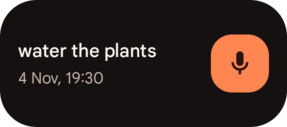
</p>

<br>

Your list, your next reminder and the next dose to take, right on the
home screen. Tick items off straight from the widget. The orange tile on
the medication widget means "still to take"; it goes quiet once the dose
is marked.

There are also two **Quick Settings tiles** and **app shortcuts**, so
dictation is one tap away from anywhere. The app offers to add them for
you.

## 🌗 Warm glass, day and night

<div align="center">
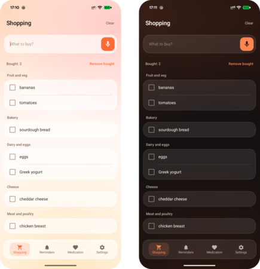
</div>

<br>

A warm frosted-glass look with one accent colour that only marks what
still needs doing. Light and dark themes, in Russian and English, switched
inside the app.

## 🔒 Your data stays yours

- **Everything lives on your phone.** The local database is the only copy:
  no account, no backend, no analytics.
- **An "Offline" switch** turns off every cloud service. Dictation and aisle
  sorting keep working on the phone.
- With the switch off, cloud help is used only when it's needed: Whisper
  speech recognition if the phone gives no text, and a language model if
  the rules aren't sure how to split the list.

## 📲 Install

1. Download **[Soroka-0.1.0.apk](https://github.com/zhukoffsky/assistant-app/releases/tag/v0.1.0)** on your phone.
2. Open it and allow installing from that app when Android asks.

**Requirements:** Android 10 or newer. Voice input for shopping needs
Android 13+ and the phone's speech model for your language (47 MB for
Russian). If it's missing, the app offers the system download at your
first dictation.

> **Test build.** The release APK has no cloud keys: recognition and
> sorting run fully on the phone. It's signed with a debug key, and it's
> not on Google Play.

## 🛠️ Build from source

```bash
./gradlew assembleDebug   # APK in app/build/outputs/apk/debug/
./gradlew test            # unit tests
```

Cloud features are optional. To turn them on, add your own keys to
`local.properties` (it's git-ignored):

```properties
zaiApiKey=…              # Z.ai, language model
cloudflareAccountId=…    # Cloudflare Workers AI: Whisper and a fallback model
cloudflareApiToken=…
```

Without them the app builds and works on-device only.

<details>
<summary><b>Under the hood</b></summary>

| Area | Choice |
|---|---|
| UI | Kotlin, Jetpack Compose, Material 3 with a custom "warm glass" theme |
| Data | Room, DataStore |
| Widgets | Glance |
| Alarms | `AlarmManager.setExactAndAllowWhileIdle`, restored on boot |
| Speech | `AudioRecord` streamed to the on-device `SpeechRecognizer`; Whisper on Cloudflare as a fallback |
| Parsing | Rules and an aisle dictionary first; an OpenAI-compatible model only when they are unsure |
| Sync | WorkManager + Google Tasks REST API |
| DI | A hand-written `AppContainer`, no Hilt |

The design notes, with every non-obvious decision and the reasoning
behind it, are in [`CLAUDE.md`](CLAUDE.md) (in Russian).

</details>

<div align="center">
<br>
<sub>Made for one family, shared with everyone.</sub>
</div>
